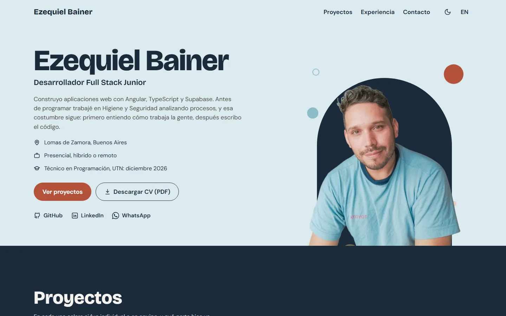
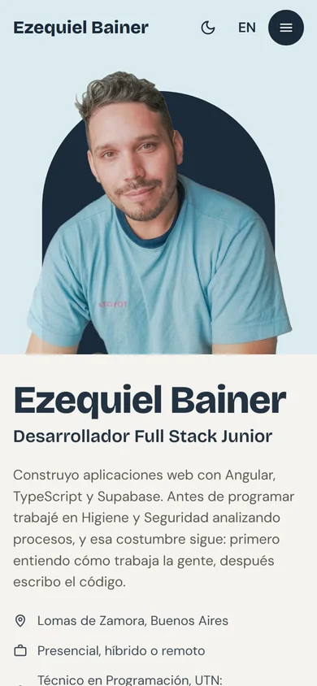

# Portfolio de Ezequiel Bainer

Mi portfolio como desarrollador Full Stack Junior: proyectos con caso de estudio, experiencia, stack y contacto, en español e inglés.

**[ezequielbainer.com.ar](https://ezequielbainer.com.ar)** · [English version](https://ezequielbainer.com.ar/en)

<p>
  
  &nbsp;
  
</p>

## Stack

- **Angular 22** con componentes standalone y signals.
- **Prerender (SSG):** cada ruta se genera como HTML estático en el build (`outputMode: "static"`). Sin servidor.
- **CSS propio** con design tokens (`src/styles/tokens.css`), sin Tailwind ni librerías de componentes.
- **Vitest** para los tests.
- **Vercel** para el deploy.

## Decisiones técnicas

**HTML estático en vez de SPA.** El SEO y la vista previa al compartir en LinkedIn o WhatsApp necesitan el HTML completo, con el `<title>`, Open Graph, canonical, `hreflang` y datos estructurados `Person` ya escritos. Todo eso lo arma `SeoService` durante el prerender, y Vercel lo sirve sin backend.

**i18n con diccionarios tipados en lugar de `@angular/localize`.** `es.ts` define la forma de todos los textos y `en.ts` está tipado con ella: si el español tiene un texto que el inglés no tiene, el build falla. Un solo build sirve los dos idiomas (`/` y `/en`), y el idioma se deduce de la URL con un `computed()`. Para un sitio de pocas páginas no hace falta XLIFF ni un build por idioma.

**Modo noche sin destello.** Un script mínimo en `index.html` aplica el tema guardado antes del primer pintado. Si no se eligió ninguno, sigue la preferencia del sistema.

**Accesibilidad (objetivo WCAG AA).** HTML semántico con link para saltar al contenido, `<button>` y `<a>` reales, foco visible y áreas táctiles de 44px. El visor de capturas usa `<dialog>` nativo con `showModal()`: el navegador resuelve el foco atrapado, Escape y el contenido inerte de atrás. Todas las animaciones se apagan con `prefers-reduced-motion`.

**Movimiento con la plataforma.** Las apariciones al scrollear usan scroll-driven animations de CSS, y la navegación entre páginas usa View Transitions (`withViewTransitions`). No hay librerías de animación.

**Logos de tecnologías generados, no dibujados.** `npm run icons` toma de [Simple Icons](https://simpleicons.org) (CC0) solo los logos que se usan y los escribe en `src/app/ui/tech-icons.ts`.

## Estructura

```
src/
├── app/
│   ├── core/          # i18n (diccionarios y rutas), SEO, tema, links y capturas
│   ├── layout/        # header y footer
│   ├── home/          # secciones de la home: hero, proyectos, experiencia, stack, sobre mí, contacto
│   ├── case-study/    # página de caso de estudio (carga diferida)
│   └── ui/            # componentes chicos: botón, tag, ícono, visor de capturas
└── styles/tokens.css  # colores, tipografía, espaciado y radios
```

## Correrlo localmente

Requiere Node 22.22 o superior (o 24.15+), lo mismo que pide Angular 22.

```bash
npm install
npm start          # servidor de desarrollo en http://localhost:4200
npm test           # tests con Vitest
npm run build      # build de producción con prerender en dist/bainer-portfolio/browser
```

Los tests revisan la estructura semántica de la página, el parseo de rutas en los dos idiomas, que los diccionarios tengan la misma forma y que cada tecnología del stack tenga su logo.

## Contacto

[LinkedIn](https://linkedin.com/in/ezequielbainer) · [GitHub](https://github.com/NEBainer) · o desde la [sección de contacto](https://ezequielbainer.com.ar/#contacto) de la web.
